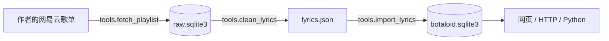

<p align="center">
  
</p>

<h1 align="center">Botaloid</h1>

<p align="center">
  用曲库里的歌词原文来聊天吧！回复也好，接龙、找歌、推荐更是不在话下！<br>
  支持本地网页使用或接入社交平台账号、群聊或网站。
</p>

<p align="center">
  <a href="LICENSE"></a>
  
  
</p>

<p align="center">
  
</p>

<p align="center">
  <sub>回答引用曲库原句，并标注曲名、署名与出处。</sub>
</p>

## 目录

- [快速开始](#快速开始)
- [接入账号、群聊或网站](#接入账号群聊或网站)
- [导入自己的数据](#导入自己的数据)
- [数据与版权](#数据与版权)
- [上游与感谢](#上游与感谢)
- [许可证](#许可证)

## 快速开始

需要 Python 3.11+，以下命令均在项目根目录运行。

### 1. 安装

Windows PowerShell：

```powershell
python -m venv .venv
.\.venv\Scripts\python -m pip install -r requirements.txt
```

Linux / macOS：

```sh
python3 -m venv .venv
.venv/bin/python -m pip install -r requirements.txt
```

后续命令以 Windows 为例，Linux / macOS 需将 `.\.venv\Scripts\python` 替换成 `.venv/bin/python`。

### 2. 准备歌词数据

你可以直接用作者的[超小众5000+曲目术力口歌单](https://music.163.com/playlist?id=8285082830) 生成曲库，首次生成约1.5小时。下面三条命令依次完成获取、清洗和导入：

```powershell
.\.venv\Scripts\python -m tools.fetch_playlist 8285082830 --output data/raw.sqlite3
.\.venv\Scripts\python -m tools.clean_lyrics data/raw.sqlite3 --output data/lyrics.json
.\.venv\Scripts\python -m tools.import_lyrics data/lyrics.json --database botaloid.sqlite3
```

`tools.fetch_playlist`仅能读取网易云歌单，`tools.clean_lyrics`同理，其按作者的歌单整理，二者皆仅为该歌单而编写。

想用自己的歌词，按[导入自己的数据](#导入自己的数据)准备 JSON 后导入。

**获取、清洗和导入工具的说明**

<details>
<summary>展开查看</summary>

| 工具 | 作用 | 输出 |
| --- | --- | --- |
| `tools.fetch_playlist` | 从网易云音乐歌单获取曲名、署名、版本信息、歌词及已有译文 | 原始 SQLite 文件 |
| `tools.clean_lyrics` | **按作者歌单整理**，清理歌词、整理署名、去重及筛选版本 | 歌词 JSON、清洗报告 |
| `tools.import_lyrics` | 校验 JSON，并导入 Botaloid 曲库 | 可供机器人使用的 SQLite 曲库 |



获取工具仅用于网易云平台，且：

- 支持普通歌单链接、带 `#/playlist?id=...` 的链接和数字 ID。
- 默认每秒发起 1 次请求，可用 `--rate` 调整请求速率。
- 中断或请求失败后，重新运行相同命令会继续未完成的部分。
- 不同歌单应使用不同的原始数据文件。

清洗工具会结合曲名、署名、专辑、原曲引用、歌词指纹和相似度来处理重复及 Remix、翻唱等歌曲版本。无法确定原版时才会保留对应版本，并在报告中标为 `review_alternate`。

- `data/lyrics.json` 可以在本地的管理页中通过「导入 JSON」进行导入。
- `data/lyrics.tsv` 用于记录排除理由、保留版本和待复核项。
- [tools/cleaning_rules.json](tools/cleaning_rules.json) 是脚本清洗完毕后，作者人工进行的修订。可编辑或通过 `--rules` 指定另一份文件；空数组 `[]` 表示不使用人工修订；按 `original_title` 标记的原版关系排除翻唱和 Remix。
- 还有获取失败或未完成的歌曲时，清洗会提示先完成获取。无歌词和纯音乐会跳过。JSON 输出文件已存在时，清洗工具会拒绝覆盖，重新导出请换一个文件名。

命令行导入则会跳过曲名、署名及逐行内容完全相同的已有曲目，保留已有曲目的启用状态。

导入以单个事务执行，出错会撤销本批写入。生成的数据默认保存在 `data/` 中。

</details>

### 3. 本地运行

```powershell
.\.venv\Scripts\python -m uvicorn app:app --host 127.0.0.1 --port 8765 --no-proxy-headers
```

之后打开[聊天界面](http://127.0.0.1:8765/)，设置页在[设置](http://127.0.0.1:8765/settings)。

> [!NOTE]
> 默认读取根目录的 `botaloid.sqlite3`；没有该文件时会识别项目改名前的旧版 `vocaloid_rag.sqlite3`。也可用 `BOTALOID_DB` 指定曲库文件。

设置页可支持查看、编辑、启用或停用曲目，也可手动新增歌曲。

管理页或命令行修改歌词后，下次检索会按曲库版本重建所需索引。启用和停用曲目即时生效。

首次需要时，程序会在曲库旁的 `<曲库文件名>.botaloid-index/` 保存可重建的检索索引。重启后按曲库版本复用 TF-IDF 索引。支持 FTS5 trigram 的 SQLite 还会用它查找明确的歌词片段或译文，回复引用对应的歌词原文。

### 4. 更换模型

进入「设置 → 模型设置」以配置模型信息。保存后下一轮聊天使用新设置。

#### OpenAI 兼容接口

适用于远程 API、LM Studio、llama.cpp、vLLM 等。填写接口地址、模型名和 API Key。地址支持主机、`/v1` 基址或完整 `/chat/completions`。

#### Ollama

先在 Ollama 安装模型，填写本地地址并选择模型。地址默认补全 `/api/chat`，可读取已安装模型。

> [!IMPORTANT]
> 模型需要能按要求输出 JSON。API Key 保存在系统凭据存储，模型地址、参数与曲库语言保存在本地 `model-settings.json`。

> [!NOTE]
> 无桌面环境可能没有可用的系统凭据存储。可设置 `BOTALOID_API_KEY`，或安装 `keyrings.alt` 并设置 `PYTHON_KEYRING_BACKEND=keyrings.alt.file.PlaintextKeyring`（明文，注意文件权限）；环境变量要设置在运行 uvicorn 的进程中。

#### 曲库语言

在「曲库语言」中填写歌词原文和译文使用的语言，以辅助模型用来生成检索词：

| 设置 | 默认 | 作用 |
| --- | --- | --- |
| 原文语言 | 日语 | 歌词原文可能使用的语言 |
| 翻译语言 | 中文 | 已有译文可能使用的语言 |

两个字段皆支持多语言，用逗号或分号分隔；可填中文名、英文名或 ISO 代码，例如 `日语, 英语`、`Japanese, English` 或 `ja, en`。

**更多详细信息**

<details>
<summary>展开查看</summary>

模型调用分两阶段，规划负责判断意图和生成检索方向，选句负责从候选歌词里选句子。

高级参数如下（留空时使用默认值）：

| 参数 | 默认行为 |
| --- | --- |
| 温度 | 规划 0.2，选句 0.55；填写后同时覆盖两个阶段 |
| 最大输出 token | Ollama 规划 320、选句 220；兼容接口不主动限制 |
| 读取超时 | 75 秒 |
| 上下文长度 | Ollama 使用 8192 |
| 允许模型先思考 | Ollama 默认关闭 |
| 推理强度 | 兼容接口默认不发送；可选 `none`、`minimal`、`low`、`medium`、`high`（OpenAI/OpenRouter 风格） |
| 请求 JSON 模式 | 兼容接口默认开启 |

推理模型会把思考过程计入 token，若上限过小 JSON 可能会被截断。

服务器也可以通过环境变量提供初始配置：

| 环境变量 | 作用 |
| --- | --- |
| `BOTALOID_MODEL_URL` | 模型接口地址；以 `/api/chat` 结尾时使用 Ollama 原生接口，其余使用 OpenAI 兼容接口 |
| `BOTALOID_MODEL` | 模型名 |
| `BOTALOID_API_KEY` | 模型服务密钥 |
| `BOTALOID_SETTINGS_FILE` | 模型配置文件位置；文件不存在时读取环境变量 |
| `BOTALOID_DB` | 曲库 SQLite 文件位置 |
| `BOTALOID_ADMIN=0` | 关闭管理页面和管理接口，保留聊天功能 |
| `BOTALOID_ADMIN_HOSTS` | 允许访问管理页的 Host，逗号分隔；默认本机地址与 localhost |
| `BOTALOID_ADMIN_NETWORKS` | 允许访问管理页的客户端 IP/CIDR，逗号分隔；默认仅 loopback |

管理页默认只允许本机访问。要从局域网访问，需要同时配置客户端网段和 Host，例如：

```sh
BOTALOID_ADMIN_NETWORKS=192.168.1.0/24
BOTALOID_ADMIN_HOSTS=192.168.1.10,server.local
```

已有配置文件优先于环境变量。服务器或容器等没有系统凭据存储的环境，可以只用环境变量：设置 `BOTALOID_MODEL_URL`、`BOTALOID_MODEL`，需要时再设置 `BOTALOID_API_KEY`，并让 `BOTALOID_SETTINGS_FILE` 指向一个尚不存在的路径，避免读到旧配置。

之后如果该路径出现配置文件，文件优先。

</details>

## 接入账号、群聊或网站

### HTTP 接入

启动服务后，从接入方后端调用 `POST /api/chat`：

```javascript
const response = await fetch("http://127.0.0.1:8765/api/chat", {
  method: "POST",
  headers: {"Content-Type": "application/json"},
  body: JSON.stringify({
    message: "想听几首写夜里散步的歌",
    history: [],
    tone: "neutral",
  }),
});
const result = await response.json();
console.log(result);
```

每个私聊、群或话题各自保存一份 `history` 和 `tone`；同一段会话按顺序调用。”

> [!WARNING]
> 对外部署时设置 `BOTALOID_ADMIN=0`，由代理层负责鉴权和限流。

### Python 接入

核心库可用 `python -m pip install .` 安装。创建 `LyricBot` 时传入曲库路径与模型调用函数。以下示例在项目根目录中运行，复用「模型设置」中保存的配置：

```python
from botaloid import LyricBot
from model_settings import active_connection, request_model

connection = active_connection()

def call_model(system, prompt, temperature, schema):
    return request_model(connection, system, prompt, temperature, schema)

bot = LyricBot("botaloid.sqlite3", call_model)
bot.initialize()
result = bot.reply("你好", history=[], tone="neutral")
print(result)
```

单独嵌入其他应用时，提供自己的 `call_model(system, prompt, temperature, schema)` 同步函数：将前两个参数分别作为系统消息和用户消息发送给模型，返回解析后的 JSON `dict`；`schema` 可供支持结构化输出的模型使用。模型故障可以抛出 `botaloid.ModelError`。

`reply()` 是同步方法，在异步机器人框架中可用工作线程调用。使用 `bot.initialize()` 初始化曲库后，歌词变更会在下次检索时自动刷新索引。也可调用 `bot.invalidate()` 释放当前实例的检索缓存。

`reply()` 还接受可选的 `original_languages` 和 `translation_languages`，用于告诉模型曲库语言；不传时使用空配置。网页端会从「模型设置 → 曲库语言」自动传入。

### 请求与返回

Python 和 HTTP 使用相同的数据结构：

| 请求字段 | 内容 |
| --- | --- |
| `message` | 当前用户消息，1～1000 字符 |
| `history` | 最多 10 条近期消息，每条包含 `role`（`user` 或 `assistant`）和 `text`（最多 1000 字符） |
| `tone` | 上一轮返回的语气；新会话使用 `neutral` |

助手历史还可包含 `intent`、按展示顺序排列的 `song_ids` 和片段 `source`。这些信息用于接龙及「第二首」「这句后面」等指代；`tone` 作为下一次请求的顶层字段回传。模型参考最近 6 条历史消息，每条最多 350 字符。

| 返回字段 | 内容 |
| --- | --- |
| `intent` | `chat` 聊天、`sing_along` 接龙、`find_song` 找歌、`find_lyrics` 找歌词、`recommend` 推荐 |
| `fragments` | 歌词原文 `text`、曲名 `title`、署名 `author` 和 `song_id`；定位到曲内位置时附 `source` |
| `songs` | 曲目 `id`、`title`、`author`；有相关原文时附 `excerpt` 和 `source` |
| `source`（片段内） | `song_id`、`start`、`end`，表示当前曲库中短句的起止位置 |
| `status` | `ok` 有结果、`no_match` 没找到、`ended` 唱到曲末 |
| `tone` | 本轮语气，传回同一段对话以延续态度 |

HTTP 参数校验失败返回 422；模型调用失败返回 503。

## 导入自己的数据

### JSON 格式

使用 UTF-8 编码，最外层是歌曲数组。可直接参考或导入自写的 [example_lyrics.json](tools/example_lyrics.json)。以下两种歌词写法都支持，也可以在一首歌中混用：

```json
[
  {
    "title": "我是示例",
    "author": "自写示例",
    "enabled": true,
    "lyrics": ["哈基米哦南北绿豆", "阿西嘎哈压库奶龙"]
  },
  {
    "title": "我也是示例",
    "author": "自写示例",
    "lyrics": [
      {"text": "一段一段带一段", "stanza": 0, "fallback": true},
      {"text": "冰冰冰", "stanza": 1, "translation": "Bing Bing Bing"}
    ]
  }
]
```

| 字段 | 要求 |
| --- | --- |
| `title` | 必填，曲名，1～500 字符 |
| `author` | 必填，署名，1～500 字符；可将作者、演唱者等用 ` / ` 合并 |
| `enabled` | 可选，默认 `true`；停用曲目不会参与回复 |
| `lyrics` | 必填，1～3000 行，每行可以是字符串或对象 |
| `lyrics[].text` | 对象写法的歌词原文，1～1800 字符 |
| `lyrics[].stanza` | 可选，默认 0；0～3000 的整数，按出现顺序不得递减 |
| `lyrics[].translation` | 可选，最多 1800 字符，译文仅参与检索，回复依旧使用原文 |
| `lyrics[].fallback` | 可选，默认 `false`；设为 `true` 后可在无合适聊天结果时作为兜底歌词 |

字符串写法等价于 stanza 为 0 的对象。混用时也要保持段落顺序。一次最多导入 10000 首；曲目 ID 由曲库生成，JSON 中无需填写来源链接或平台 ID。

### 导入方式

- **管理页**：进入「设置 → 曲库管理 → 导入 JSON」，选择文件。少量歌曲也可用「新增歌曲」手动录入。
- **命令行**：使用与管理页相同的 JSON 格式，导入前无需启动网页服务：

```powershell
.\.venv\Scripts\python -m tools.import_lyrics "自己的歌词.json" --database botaloid.sqlite3
```

两种方式都向现有曲库追加数据。管理页每次都会新增曲目；命令行会跳过完全相同的已有记录。相同曲名但内容不同的记录仍会导入，可随后在曲库管理中复核和停用。

## 数据与版权

> [!WARNING]
> 歌词和译文的权利归各自权利人；工具代码的许可不包含对第三方内容的授权。采集、导入及后续使用应符合相应授权、平台规则和适用法律。

工具由使用者在本地运行，原始数据、导出歌词和曲库文件保存在使用者选择的位置。获取依赖平台接口，接口及可获取范围可能变化。

代码许可见[许可证](#许可证)；随附字体按其自身许可证使用。

## 上游与感谢

- [FastAPI](https://fastapi.tiangolo.com/)、[Pydantic](https://docs.pydantic.dev/)、[Uvicorn](https://www.uvicorn.org/)：HTTP 服务和数据校验。
- [scikit-learn](https://scikit-learn.org/)、[NumPy](https://numpy.org/)：字符 TF-IDF 检索和数值计算。
- [Requests](https://requests.readthedocs.io/)、[keyring](https://github.com/jaraco/keyring)：模型与数据请求、系统凭据存储。
- [Ollama](https://ollama.com/) 及 OpenAI 兼容接口的模型服务。
- [小赖等宽](https://github.com/lxgw/kose-font/releases/tag/v3.126)：本地界面字体，许可证见 [OFL-Xiaolai.txt](web/assets/fonts/OFL-Xiaolai.txt)。
- 感谢 [bilibili @Richardn2002](https://space.bilibili.com/213997744) 提供的数据建议。

感谢原作者、演唱者和歌词及译文的贡献者。

## 许可证

本项目代码以 [MIT 许可证](LICENSE) 发布。

歌词、译文等第三方内容不在该许可范围内，详见[数据与版权](#数据与版权)。
