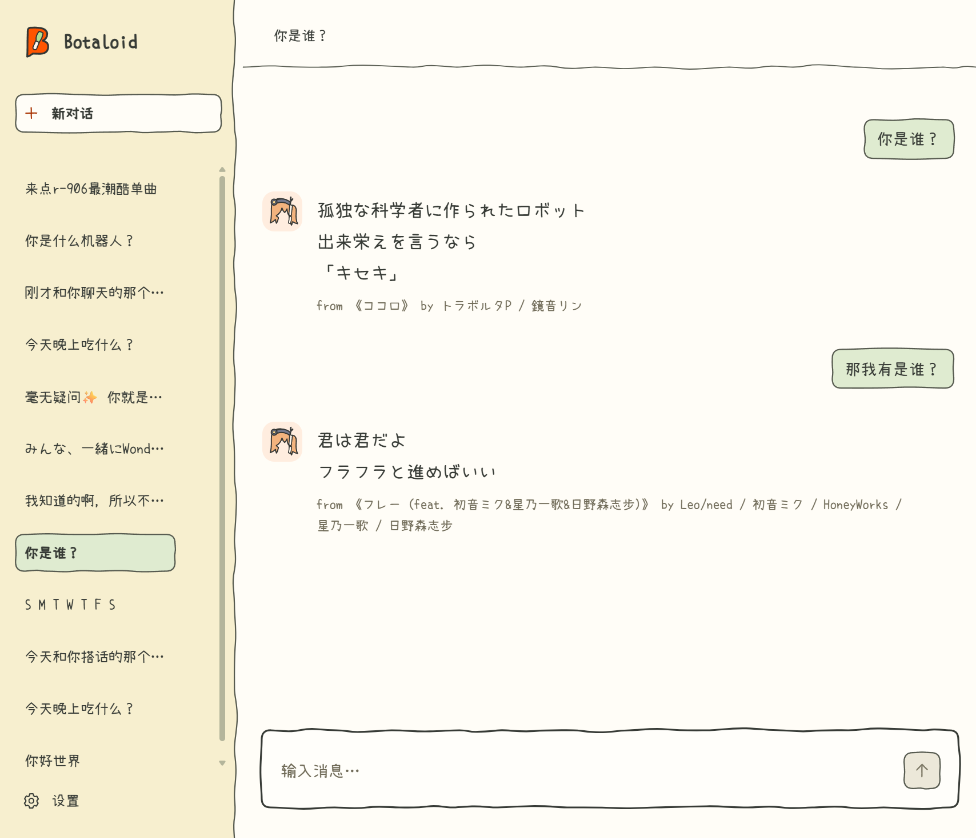

<p align="center">
  
</p>

<h1 align="center">Botaloid</h1>

<p align="center">
  基于 RAG 的歌词回复聊天机器人。聊天与接龙直接引用曲库歌词原文，找歌与推荐返回曲目信息及歌词摘录。<br>
  自带本地 Web 界面，并提供 HTTP API 与 Python 接口供接入各类聊天平台。
</p>

<p align="center">
  <a href="LICENSE"></a>
  
  
</p>

<p align="center">
  
</p>

<p align="center">
  <sub>聊天与接龙引用曲库原词并标注出处，找歌与推荐返回曲目信息及歌词摘录。</sub>
</p>

> [!NOTE]
> 这是一个个人向的玩具项目，开源主要是为了公开代码，后续大概率不再维护。
> 仓库本身未内置版权歌词数据（仅附自写的示例文件）。检索使用通用的字符 1–3 gram 与 SQLite FTS5，歌词分句与跨行合并包含日语规则，配套的抓取与清洗脚本也是围绕作者自己的术力口歌单编写的；你也可以通过标准 JSON 导入任意语种的歌词库。

## 目录

- [快速开始](#快速开始)
- [模型与部署配置](#模型与部署配置)
- [接入账号、群聊或网站](#接入账号群聊或网站)
- [导入自己的数据](#导入自己的数据)
- [数据与版权](#数据与版权)
- [上游与感谢](#上游与感谢)
- [许可证](#许可证)

## 快速开始

需要 Python 3.11+，以下命令均在项目根目录运行。

### 1. 安装依赖

Windows PowerShell：

```powershell
python -m venv .venv
.\.venv\Scripts\python -m pip install -r requirements.txt
```

Linux / macOS：

```sh
python3 -m venv .venv
.venv/bin/python -m pip install -r requirements.txt
```

后续命令以 Windows 为例，Linux / macOS 将 `.\.venv\Scripts\python` 替换为 `.venv/bin/python` 即可。

### 2. 导入示例曲库并启动

先用仓库自带的示例文件生成曲库，几秒内即可跑通：

```powershell
.\.venv\Scripts\python -m tools.import_lyrics tools/example_lyrics.json --database botaloid.sqlite3
.\.venv\Scripts\python -m uvicorn app:app --host 127.0.0.1 --port 8765 --no-proxy-headers
```

启动后访问 `http://127.0.0.1:8765/`：
1. **免模型验证**：直接在聊天框发送 `查歌词：哈基米哦南北绿豆`，无需配置模型即可看到检索回复。
2. **配置模型聊天**：打开 `http://127.0.0.1:8765/settings`，进入「设置 → 模型设置」填好模型接口并保存，即可回到聊天页体验完整对话。

服务默认读取项目根目录下的 `botaloid.sqlite3`（可通过环境变量 `BOTALOID_DB` 修改）。Web 首次启动时会等待索引就绪；运行期间在管理页编辑歌词或译文后会在后台异步重建并切换，不中断当前聊天。如果需要提前建好索引再启动，可运行 `.\.venv\Scripts\python -m botaloid.prepare_index botaloid.sqlite3`。

### 3. 准备完整曲库（可选）

除了自己准备 JSON 导入外，也可以直接用作者的[超小众5000+曲目术力口歌单](https://music.163.com/playlist?id=8285082830)生成曲库（首次完整抓取和构建约需 1.5 小时）。

由于 `import_lyrics` 是追加写入，建议导入到独立的库文件（避免把上一步的示例曲目和示例兜底句混进正式曲库），再用 `BOTALOID_DB` 指向它；或者先删除示例阶段生成的 `botaloid.sqlite3` 再导入：

```powershell
.\.venv\Scripts\python -m tools.fetch_playlist 8285082830 --output data/raw.sqlite3
.\.venv\Scripts\python -m tools.clean_lyrics data/raw.sqlite3 --output data/lyrics.json
.\.venv\Scripts\python -m tools.import_lyrics data/lyrics.json --database data/full.sqlite3
$env:BOTALOID_DB = "data/full.sqlite3"
.\.venv\Scripts\python -m uvicorn app:app --host 127.0.0.1 --port 8765 --no-proxy-headers
```

<details>
<summary>数据处理工具补充说明</summary>

- `tools.fetch_playlist` 仅支持网易云音乐歌单（接受歌单链接或数字 ID），默认每秒 1 次请求（可用 `--rate` 调整）。中断后可用同一个原始 SQLite 文件断点续传，前提是歌单里的曲目和顺序未发生变化。
- `tools.clean_lyrics` 是专门按作者歌单整理的清洗脚本，结合 [tools/cleaning_rules.json](tools/cleaning_rules.json) 处理署名、去重及过滤翻唱/Remix。`--rules` 接收 JSON 文件路径；若要停用人工规则，可新建一个内容为 `[]` 的文件并传入（如 `--rules empty-rules.json`）。默认会同步输出同名 `.tsv` 清洗报告（也可用 `--report` 指定路径）。
- `tools.import_lyrics` 校验并写入 SQLite 曲库，自动跳过曲名、署名及逐行段号/原文/译文/兜底标记完全一致的已有曲目，并保留其启停状态。

</details>

## 模型与部署配置

进入 Web 界面的「设置 → 模型设置」即可配置模型，保存后下一轮对话生效。

### 模型要求与接口支持

Botaloid 的普通聊天通常会经过**规划检索词 → 检索候选 → 选句/兜底校验**流程（不合适时自动换方向重规划，仍无结果时再尝试保底歌词），因此：
1. **模型必须能稳定输出符合要求的 JSON**。
2. 单次用户输入可能触发多次模型调用，响应延迟和 token 消耗会高于普通单轮对话。

支持的接入方式：
- **OpenAI 兼容接口**：适用于官方 API、中转站、LM Studio、llama.cpp、vLLM 等。填写接口地址（支持主机地址、`/v1` 或完整 `/chat/completions`）、模型名和 API Key。在网页录入并保存非本机地址的 API Key 时，强制要求 HTTPS。
- **Ollama**：填写本地地址（默认补全 `/api/chat`）并选择已安装模型即可。

> [!IMPORTANT]
> API Key 默认保存在系统凭据存储（keyring）中，其余配置保存在本地 `model-settings.json`。
> 在**无桌面环境的 Linux 服务器或 Docker 容器**中通常没有可用的 keyring 服务，建议直接用环境变量启动：将 `BOTALOID_SETTINGS_FILE` 指向一个尚未存在的配置文件路径，并配置 `BOTALOID_MODEL_URL`、`BOTALOID_MODEL` 和 `BOTALOID_API_KEY`（环境变量配置不触发网页端的 HTTPS 强制校验）。如果之后在网页修改并保存了其他参数，只要保持接口地址不变且 API Key 留空，配置文件就会继续沿用 `BOTALOID_API_KEY`。也可以改用安装 `keyrings.alt` 并设置 `PYTHON_KEYRING_BACKEND=keyrings.alt.file.PlaintextKeyring`（明文存储，注意文件权限）。

### 曲库语言设置

模型在规划检索词时会参考「设置 → 模型设置 → 曲库语言」的配置（支持中英文名称或 ISO 代码，多语言用逗号或分号分隔）：
- **原文语言**（默认 `日语`）：歌词原文使用的语言。
- **翻译语言**（默认 `中文`）：已有译文使用的语言。译文会参与检索并辅助模型选句，最终回复仍引用歌词原文。

### 环境变量与管理页权限（无头部署必看）

在 VPS、Docker 或反代环境中，可通过环境变量提供初始模型配置并限制管理路由访问：

| 环境变量 | 作用 |
| --- | --- |
| `BOTALOID_DB` | 曲库 SQLite 文件路径（默认 `botaloid.sqlite3`） |
| `BOTALOID_SETTINGS_FILE` | 模型配置文件路径（默认 `model-settings.json`）；文件存在时地址与模型名以文件为准 |
| `BOTALOID_MODEL_URL` | 模型接口地址；以 `/api/chat` 结尾时走 Ollama 原生接口，其余走 OpenAI 兼容接口 |
| `BOTALOID_MODEL` | 模型名称 |
| `BOTALOID_API_KEY` | 模型 API Key（仅当配置处于环境变量引用模式且地址与 `BOTALOID_MODEL_URL` 一致时生效） |
| `BOTALOID_ADMIN=0` | 关闭管理页面与管理接口，仅保留聊天网页与聊天 API（**对外暴露服务时建议开启**） |
| `BOTALOID_ADMIN_HOSTS` | 允许访问管理页的 `Host` 白名单，逗号分隔（默认本机与 `localhost`） |
| `BOTALOID_ADMIN_NETWORKS` | 允许访问管理页的客户端 IP/CIDR，逗号分隔（默认仅 loopback） |

管理路由会同时校验客户端 IP 和 `Host`，带 `Origin` 的 `POST`/`PUT`/`PATCH` 还须同源。如果需要在局域网内访问管理页，需要 `export` 上述两项变量并让 Uvicorn 监听内网可达的地址（例如 `--host 0.0.0.0` 或内网 IP，本地直连时保留 `--no-proxy-headers` 以按真实连接 IP 校验）：

```sh
export BOTALOID_ADMIN_NETWORKS=192.168.1.0/24
export BOTALOID_ADMIN_HOSTS=192.168.1.10,server.local
.venv/bin/python -m uvicorn app:app --host 192.168.1.10 --port 8765 --no-proxy-headers
```

<details>
<summary>模型高级参数与内置快捷指令说明</summary>

- **免模型快捷查询**：对于唯一命中的 `找歌：原文片段`、`查歌词：原文片段`（无待消歧的作者/曲名条件），以及已有核验出处的 `下一句`、`上一句`、`前后文`，会直接查库返回，不调用模型。
- **高级参数默认值**（设置页留空即用默认）：
  - **温度**：规划阶段 `0.2`，选句阶段 `0.55`（填写后同时覆盖两阶段）。
  - **最大输出 token**：Ollama 默认规划 `512`、选句 `1024`；OpenAI 兼容接口默认省略该参数，由上游决定。
  - **读取超时**：Web 端每轮默认共用 `75` 秒预算，临近超时会提前转入保底检索。
  - **Ollama 上下文长度**：默认 `8192`；「允许模型先思考再作答」默认关闭。
  - **兼容接口推理参数**：「请求 JSON 模式」默认开启；「推理强度」默认不发送（可选 `none`、`minimal`、`low`、`medium`、`high`）。
- 请求失败、超时、模型输出被截断或无法解析时，`/api/chat` 返回 HTTP `503`。开启 INFO 日志可查看每轮耗时与上游返回的 `usage` token 统计。

</details>

## 接入账号、群聊或网站

### 1. HTTP 接口接入

> [!WARNING]
> 对公网暴露服务时，务必设置 `BOTALOID_ADMIN=0`，并在前端反代层做好鉴权与限流。
> 服务默认未开启 CORS，**请从接入方后端调用**（不要直接从第三方网站的前端页面跨域请求）。

#### 标准请求：`POST /api/chat`

```javascript
// 从接入方后端调用
const response = await fetch("http://127.0.0.1:8765/api/chat", {
  method: "POST",
  headers: {"Content-Type": "application/json"},
  body: JSON.stringify({
    message: "想听几首写夜里散步的歌",
    history: [],
    tone: "neutral",
  }),
});
const result = await response.json();
console.log(result);
```

接入多个私聊或群聊时，请按会话各自维护 `history` 和 `tone`，并确保同一会话按顺序串行调用。

#### 多轮上下文示例（`查歌词` → `下一句`）

要把「下一句 / 接龙」等上下文核验接起来，**写入 `assistant` 历史中的 `text` 必须是首轮返回的原始歌词 `fragments[].text`**，不能把拼接了曲名、作者的展示文本填进去，否则核验会失效并退回模型规划。

第一轮请求：

```json
{
  "message": "查歌词：哈基米哦南北绿豆",
  "history": [],
  "tone": "neutral"
}
```

第一轮返回：

```json
{
  "status": "ok",
  "intent": "find_lyrics",
  "fragments": [
    {
      "text": "哈基米哦南北绿豆",
      "title": "我是示例",
      "author": "自写示例",
      "song_id": 1,
      "source": {"song_id": 1, "start": 0, "end": 0}
    }
  ],
  "tone": "neutral"
}
```

第二轮请求（将首轮 `fragments[0].text` 与 `source` 原样写入 `history`）：

```json
{
  "message": "下一句",
  "history": [
    {"role": "user", "text": "查歌词：哈基米哦南北绿豆"},
    {
      "role": "assistant",
      "text": "哈基米哦南北绿豆",
      "intent": "find_lyrics",
      "song_ids": [1],
      "source": {"song_id": 1, "start": 0, "end": 0}
    }
  ],
  "tone": "neutral"
}
```

第二轮预期返回（同样不经过模型，直接返回下一句）：

```json
{
  "status": "ok",
  "intent": "find_lyrics",
  "fragments": [
    {
      "text": "阿西嘎哈压库奶龙",
      "title": "我是示例",
      "author": "自写示例",
      "song_id": 1,
      "source": {"song_id": 1, "start": 1, "end": 1}
    }
  ],
  "tone": "neutral"
}
```

#### 流式进度事件：`POST /api/chat/events`

如果机器人前端需要展示当前处理阶段，可改用 `/api/chat/events`。请求体相同，返回 `application/x-ndjson`（逐行 JSON）：
- 过程事件为 `stage`（包含 `planning`、`retrieving`、`selecting`、`validating`、`replanning`、`fallback`、`curated`）或 `keepalive`。
- 流结束时仅发送一次 `result`（完整返回对象）或 `error`（包含 `detail`）。

请求参数校验失败时两个接口均返回 `422`；模型或索引异常在 `/api/chat` 中返回 `503`，在事件流中通过 `error` 事件传递。

### 2. Python 直接嵌入

如果不想起 HTTP 服务，可以在项目根目录运行 `python -m pip install .` 安装核心包 `botaloid`（核心包仅有一个直接运行时依赖 `pydantic>=2,<3`）。下面的独立示例复用快速开始生成的 `botaloid.sqlite3` 演示免模型查歌词；真正进行自由聊天时，在 `call_model` 中接入你的模型即可：

```python
from botaloid import LyricBot, ModelError

def call_model(system: str, prompt: str, temperature: float, schema: dict) -> dict:
    # 自由聊天、找歌或推荐时在这里调用你的模型，并返回解析后的 JSON dict
    raise ModelError("请先在 call_model 中接入模型")

bot = LyricBot("botaloid.sqlite3", call_model)
bot.initialize()
result = bot.reply("查歌词：哈基米哦南北绿豆", history=[], tone="neutral")
print(result)
```

如果你是在仓库内运行且已安装 `requirements.txt`，也可以直接复用 Web 版「模型设置」保存的模型连接来跑完整对话：

```python
from botaloid import LyricBot
from model_settings import active_connection, request_model

connection = active_connection()
bot = LyricBot(
    "botaloid.sqlite3",
    lambda system, prompt, temperature, schema: request_model(
        connection, system, prompt, temperature, schema
    ),
)
bot.initialize()
result = bot.reply("你好", history=[], tone="neutral")
print(result)
```

嵌入自有框架的要点：
- **`call_model(system, prompt, temperature, schema)`**：需为同步函数，接收系统提示词、用户提示词、温度及 JSON Schema，返回解析后的 `dict`；模型调用异常可抛出 `botaloid.ModelError`。
- **异步机器人框架（如 NoneBot / python-telegram-bot / discord.py）**：`bot.reply()` 是同步方法，请用 `asyncio.to_thread` 放到工作线程中执行。
- **可选参数**：`reply()` 支持传入 `history_limit`（0～100，默认 6）、`original_languages`、`translation_languages`、`progress` 回调以及 `deadline`（`time.monotonic()` 绝对截止时间，建议在 `call_model` 内据此设置超时）。
- **只读部署与后台热更新**：
  - 只读曲库部署时，先执行 `python -m botaloid.prepare_index botaloid.sqlite3`，将数据库连同旁边的 `botaloid.sqlite3.botaloid-index/` 目录一起部署，再分两步初始化（`initialize()` 返回 `None`，请先保留实例）：
    ```python
    bot = LyricBot("botaloid.sqlite3", call_model, read_only=True)
    bot.initialize()
    ```
    索引缺失或不匹配会抛出 `botaloid.SearchIndexError`。
  - 需要在运行期间后台异步重建并切换快照时，可在 `bot.initialize()` 后使用 `botaloid.library.ServingLibrary(bot)`（依次调用 `start()`、`reply()`、退出时 `close()`）。

### 3. 请求与返回结构说明

Python 与 HTTP 接口共用同一套数据结构。

**请求字段：**

| 字段 | 说明 |
| --- | --- |
| `message` | 当前用户消息，1～1000 字符 |
| `history` | 按时间从早到晚排列的历史记录（最多传 100 条，单条 `text` 最多 1000 字符；实际按 `history_limit` 取末尾最近几条，默认 6 条，传给模型时每条文本最多截断至 350 字符） |
| `tone` | 上一轮返回的 `tone`；新会话传 `"neutral"` |

> [!TIP]
> **拼接 `history` 时的关键字段**：每条历史必须包含 `role`（`user` / `assistant`）和 `text`（写入原始歌词而非拼装后的展示文本）。为了保证接龙、指代上一轮歌曲和延续筛选条件正常，写入 `assistant` 历史时，建议从上一轮返回结果中带上：
> - `intent`、`conditions`（如有）以及末项的 `source`（包含 `revision` 时原样保留）。
> - `song_ids`：由接入方从上一轮返回的 `songs[].id` 或 `fragments[].song_id` 按出现顺序去重后组装。
> - 若上一轮为保底回复，还应带上 `fallback` 和 `requested_intent`。

**返回字段：**

| 字段 | 说明 |
| --- | --- |
| `status` | `ok`（成功返回原文或曲目，含保底成功）、`no_match`（无可用结果）、`ended`（接龙已唱到曲末） |
| `intent` | `chat`（聊天）、`sing_along`（接龙）、`find_song`（找歌）、`find_lyrics`（找歌词）、`recommend`（推荐） |
| `fragments` | 选中的歌词片段列表，含原文 `text`、曲名 `title`、署名 `author`、`song_id`，定位到曲内位置时附 `source` |
| `songs` | 推荐或找歌时的曲目列表，含 `id`、`title`、`author`，有摘录时附 `excerpt` 与 `source` |
| `source` | 曲内定位 `{song_id, start, end}`（短句下标从 0 开始，闭区间；Web 发布器会附加 `revision`） |
| `conditions` | 可选，已解析的筛选条件（`title`、`author`、`directions`） |
| `fallback` | 保底成功时为 `true` |
| `requested_intent` | 触发保底前的原始 `intent` |
| `ended` | 仅 `status == "ended"` 时为 `true` |
| `tone` | 本轮语气，下一轮请求原样传回 |

## 导入自己的数据

### JSON 格式

使用 UTF-8 编码，最外层为歌曲数组（单批最多 10000 首，可参考 [tools/example_lyrics.json](tools/example_lyrics.json)）。`lyrics` 支持纯字符串或对象，也可以混用：

```json
[
  {
    "title": "我是示例",
    "author": "自写示例",
    "enabled": true,
    "lyrics": ["哈基米哦南北绿豆", "阿西嘎哈压库奶龙"]
  },
  {
    "title": "我也是示例",
    "author": "自写示例",
    "lyrics": [
      {"text": "一段一段带一段", "stanza": 0, "fallback": true},
      {"text": "冰冰冰", "stanza": 1, "translation": "Bing Bing Bing"}
    ]
  }
]
```

| 字段 | 要求 |
| --- | --- |
| `title` | 必填，曲名，1～500 字符 |
| `author` | 必填，署名，1～500 字符（多个创作者/歌手建议用 ` / ` 合并） |
| `enabled` | 可选，默认 `true`；设为 `false` 的曲目不会参与回复 |
| `lyrics` | 必填，1～3000 行 |
| `lyrics[].text` | 对象写法的歌词原文，1～1800 字符 |
| `lyrics[].stanza` | 可选，默认 `0`（0～3000 的整数）；同一首歌内按出现顺序不得递减 |
| `lyrics[].translation` | 可选，最多 1800 字符；参与检索与辅助选句，最终回复仍使用原文 |
| `lyrics[].fallback` | 可选，默认 `false`；标记为人工兜底句（普通检索与全库保底检索都未选中时才从中挑选） |

### 导入方式

- **Web 管理页**：进入「设置 → 曲库管理 → 导入 JSON」上传（少量歌曲也可在页面手动「新增歌曲」）。该方式会逐首新增曲目。
- **命令行**（无需启动 Web 服务；会跳过曲名、署名及逐行段号/原文/译文/兜底标记完全相同的已有曲目，并保留其启停状态）：

```powershell
.\.venv\Scripts\python -m tools.import_lyrics "自己的歌词.json" --database botaloid.sqlite3
```

## 数据与版权

> [!WARNING]
> 本项目仅包含程序代码与自写的简短示例，完整曲库需由使用者自行生成或导入。歌词和译文的版权归各自权利人所有，代码许可证不涵盖对第三方内容的授权；采集、导入及部署使用请自行遵守对应平台规则与适用法律。

抓取、清洗与导入脚本均在本地运行，数据文件保存在本地路径；平台抓取工具依赖第三方接口，不保证长期可用。随附字体按其自身许可证使用。

## 上游与感谢

- [FastAPI](https://fastapi.tiangolo.com/)、[Pydantic](https://docs.pydantic.dev/)、[Uvicorn](https://www.uvicorn.org/)：HTTP 服务与数据校验。
- [SQLite](https://www.sqlite.org/)：曲库存储与倒排 / FTS5 检索支持。
- [Requests](https://requests.readthedocs.io/)、[keyring](https://github.com/jaraco/keyring)：网络请求与系统凭据存储。
- [Ollama](https://ollama.com/) 及各类 OpenAI 兼容模型服务。
- [小赖等宽](https://github.com/lxgw/kose-font/releases/tag/v3.126)：本地界面字体，许可证见 [OFL-Xiaolai.txt](web/assets/fonts/OFL-Xiaolai.txt)。
- 感谢 [bilibili @Richardn2002](https://space.bilibili.com/213997744) 提供的数据建议和使用反馈。

感谢所有词曲作者、演唱者及歌词与译文的整理贡献者。

## 许可证

本项目代码基于 [MIT 许可证](LICENSE) 开源；歌词、译文等第三方内容不在该许可范围内。