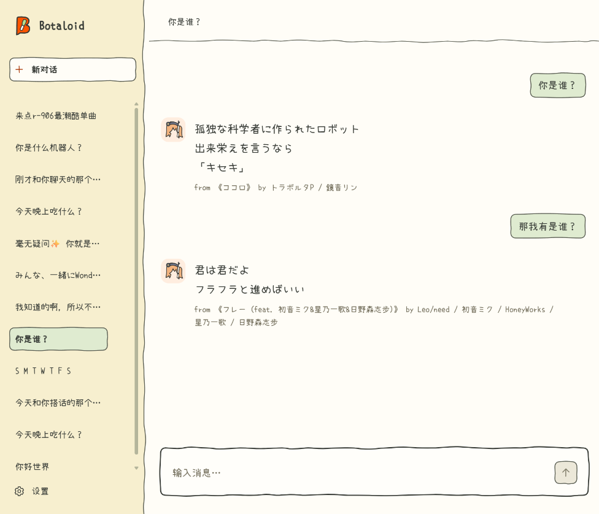

<p align="center">
  
</p>

<h1 align="center">Botaloid</h1>

<p align="center">
  用曲库里的歌词原文来聊天吧！回复也好，接龙、找歌、推荐更是不在话下！<br>
  支持本地网页使用或接入社交平台账号、群聊或网站。
</p>

<p align="center">
  <a href="LICENSE"></a>
  
  
</p>

<p align="center">
  
</p>

<p align="center">
  <sub>回答引用曲库原句，并标注曲名、署名与出处。</sub>
</p>

## 目录

- [快速开始](#快速开始)
- [接入账号、群聊或网站](#接入账号群聊或网站)
- [导入自己的数据](#导入自己的数据)
- [数据与版权](#数据与版权)
- [上游与感谢](#上游与感谢)
- [许可证](#许可证)

## 快速开始

需要 Python 3.11+，以下命令均在项目根目录运行。

### 1. 安装

Windows PowerShell：

```powershell
python -m venv .venv
.\.venv\Scripts\python -m pip install -r requirements.txt
```

Linux / macOS：

```sh
python3 -m venv .venv
.venv/bin/python -m pip install -r requirements.txt
```

后续命令以 Windows 为例，Linux / macOS 需将 `.\.venv\Scripts\python` 替换成 `.venv/bin/python`。

### 2. 准备歌词数据

你可以直接用作者的[超小众5000+曲目术力口歌单](https://music.163.com/playlist?id=8285082830) 生成曲库，首次生成约1.5小时。下面三条命令依次完成获取、清洗和导入：

```powershell
.\.venv\Scripts\python -m tools.fetch_playlist 8285082830 --output data/raw.sqlite3
.\.venv\Scripts\python -m tools.clean_lyrics data/raw.sqlite3 --output data/lyrics.json
.\.venv\Scripts\python -m tools.import_lyrics data/lyrics.json --database botaloid.sqlite3
```

`tools.fetch_playlist`仅能读取网易云歌单，`tools.clean_lyrics`同理，其按作者的歌单整理，二者皆仅为该歌单而编写。

想用自己的歌词，按[导入自己的数据](#导入自己的数据)准备 JSON 后导入。

**获取、清洗和导入工具的说明**

<details>
<summary>展开查看</summary>

| 工具 | 作用 | 输出 |
| --- | --- | --- |
| `tools.fetch_playlist` | 从网易云音乐歌单获取曲名、署名、版本信息、歌词及已有译文 | 原始 SQLite 文件 |
| `tools.clean_lyrics` | **按作者歌单整理**，清理歌词、整理署名、去重及筛选版本 | 歌词 JSON、清洗报告 |
| `tools.import_lyrics` | 校验 JSON，并导入 Botaloid 曲库 | 可供机器人使用的 SQLite 曲库 |


获取工具仅用于网易云平台，且：

- 支持普通歌单链接、带 `#/playlist?id=...` 的链接和数字 ID。
- 默认每秒发起 1 次请求，可用 `--rate` 调整请求速率。
- 中断或请求失败后，重新运行相同命令会继续未完成的部分。
- 不同歌单应使用不同的原始数据文件。

清洗工具会结合曲名、署名、专辑、原曲引用、歌词指纹和相似度来处理重复及 Remix、翻唱等歌曲版本。无法确定原版时才会保留对应版本，并在报告中标为 `review_alternate`。

- `data/lyrics.json` 可以在本地的管理页中通过「导入 JSON」进行导入。
- `data/lyrics.tsv` 用于记录排除理由、保留版本和待复核项。
- [tools/cleaning_rules.json](tools/cleaning_rules.json) 是脚本清洗完毕后，作者人工进行的修订。可编辑或通过 `--rules` 指定另一份文件；空数组 `[]` 表示不使用人工修订；按 `original_title` 标记的原版关系排除翻唱和 Remix。
- 还有获取失败或未完成的歌曲时，清洗会提示先完成获取。无歌词和纯音乐会跳过。JSON 输出文件已存在时，清洗工具会拒绝覆盖，重新导出请换一个文件名。

命令行导入则会跳过曲名、署名及逐行内容完全相同的已有曲目，保留已有曲目的启用状态。

导入以单个事务执行，出错会撤销本批写入。生成的数据默认保存在 `data/` 中。

</details>

### 3. 本地运行

```powershell
.\.venv\Scripts\python -m uvicorn app:app --host 127.0.0.1 --port 8765 --no-proxy-headers
```

之后打开[聊天界面](http://127.0.0.1:8765/)，设置页见[设置](http://127.0.0.1:8765/settings)。

> [!NOTE]
> 默认曲库是项目根目录下的 `botaloid.sqlite3`，也可用 `BOTALOID_DB` 指定路径。
>
> 网页启动时准备曲库快照与配套索引；首次缺少可用索引时需等待构建完成。运行期间编辑歌词或译文后，系统在后台准备待发布快照及其索引，聊天继续使用服务中的快照，准备完成后统一切换。也可以在启动前运行 `.\.venv\Scripts\python -m botaloid.prepare_index botaloid.sqlite3`，将最后一个参数换成实际曲库路径。

设置页可查看、编辑、启用或停用曲目，也可手动新增歌曲。

**有关索引的详细信息**

<details>
<summary>展开查看</summary>

检索索引位于曲库旁的 `<曲库文件名>.botaloid-index/search-v1-<generation>-<token>.sqlite3`。它保存规范化的整曲原文、字符 1–3 gram 倒排索引和全库 IDF。词表按总词频保留至多 100000 项。多个字符特征组合查询时对完整倒排表计分，避免高频特征的候选截断漏掉综合得分较高的歌词；单特征查询在可保证结果完整时使用高权重命中表。

曲库内容的修订号由 `botaloid_lyric_revision` 表与写入触发器维护，用于核对歌词数据与索引是否匹配。网页在索引目录的 `published/` 下保存配套的曲库快照和索引，由后台子进程准备待发布快照，完成后统一切换。进行中的请求持有开始处理时的快照，切换后在最后一个读者结束时回收已停用的快照；构建失败时继续使用服务中的快照，并在曲库管理页显示状态。曲目启停、歌名和作者实时读取，歌曲身份标记防止删除后复用 ID 导致歌词与出处错配。索引目录不可写时，网页可在系统临时目录准备快照和索引。

原文精确查询支持跨行匹配。找歌或找歌词时，如果原文精确匹配未命中、未指定上下句等相对位置，且规范化后的线索至少有 3 个字符，支持 FTS5 trigram 的 SQLite 会对原文和译文做子串检索。需要近似匹配时使用字符倒排索引。命中译文时引用对应的歌词原文。

`找歌：原文片段`、`查歌词：原文片段` 唯一匹配且无待解析的作者或曲名条件时，以及有已核验出处的 `下一句`、`上一句`、`前后文`，可直接查询而不调用模型。

索引目录可以从曲库重新生成。

</details>

### 4. 更换模型

进入「设置 → 模型设置」以配置模型信息。保存后下一轮聊天使用新设置。

#### OpenAI 兼容接口

适用于远程 API、LM Studio、llama.cpp、vLLM 等。填写接口地址、模型名和 API Key。地址支持主机、`/v1` 基址或完整 `/chat/completions`。

模型列表：`POST /api/model-settings/models`，body `{provider, url, api_key, clear_key}`。未传 `api_key` 时，若 URL 与已保存配置一致则使用已保存的 Key。远程地址发送 Key 强制 HTTPS（loopback 除外）。上游非 200 或返回格式不兼容时返回 502，detail 区分重定向、401/403/404/429/5xx 与格式不兼容；连接超时 4s、读取 6s，禁用重定向。

#### Ollama

先在 Ollama 安装模型，填写本地地址并选择模型。地址默认补全 `/api/chat`，可读取已安装模型。

> [!IMPORTANT]
> 模型需要能按要求输出 JSON。API Key 保存在系统凭据存储，模型地址、参数与曲库语言保存在本地 `model-settings.json`。

> [!NOTE]
> 无桌面环境可能没有可用的系统凭据存储。可设置 `BOTALOID_API_KEY`，或安装 `keyrings.alt` 并设置 `PYTHON_KEYRING_BACKEND=keyrings.alt.file.PlaintextKeyring`（明文，注意文件权限）；环境变量要设置在运行 uvicorn 的进程中。

#### 曲库语言

在「曲库语言」中填写歌词原文和译文使用的语言，以辅助模型用来生成检索词：

| 设置 | 默认 | 作用 |
| --- | --- | --- |
| 原文语言 | 日语 | 歌词原文可能使用的语言 |
| 翻译语言 | 中文 | 已有译文可能使用的语言 |

两个字段皆支持多语言，用逗号或分号分隔；可填中文名、英文名或 ISO 代码，例如 `日语, 英语`、`Japanese, English` 或 `ja, en`。

**更多详细信息**

<details>
<summary>展开查看</summary>

模型调用分为规划和选句两个阶段。正常检索没有得到合适选句时，系统将失败方向及原因交给模型，最多换两次方向；仍未选出时，根据上下文生成表达做不到、不知道、没找到、拒绝或安抚等态度的检索词，在符合条件的曲库中寻找保底歌词。保底检索仍未选出时，才从人工标记的兜底歌词中选句。首轮成功即返回，完整流程最多四次规划、五次选句。

最终回复由程序按候选编号提取并核对歌词原文与出处。歌词可以用于直答、比喻、反问、拒绝或安抚；模型生成的自由文本、译文和改写内容不会作为回复。用户指定歌词语言时，由模型在选句阶段判断语言要求，程序核验原文及出处。系统不向用户索要补充信息；仍无可用结果时返回 `no_match`。

网页按实际阶段显示等待信息，完成后一次性追加回复。已发出的回复不提供重生成或候选挑选；切换对话会保存用户自己输入的草稿。

高级参数如下（留空时使用默认值）：

| 参数 | 默认行为 |
| --- | --- |
| 温度 | 规划 0.2，选句 0.55；填写后同时覆盖两个阶段 |
| 最大输出 token | Ollama 规划 320、选句 220；兼容接口不主动限制 |
| 读取超时 | 默认 75 秒；网页各轮规划和选句共用本轮剩余等待预算，换方向不重置预算；剩余时间较少时提前进入保底检索 |
| 上下文长度 | Ollama 使用 8192 |
| 允许模型先思考 | Ollama 默认关闭 |
| 推理强度 | 兼容接口默认不发送；可选 `none`、`minimal`、`low`、`medium`、`high`（OpenAI/OpenRouter 风格） |
| 请求 JSON 模式 | 兼容接口默认开启 |

`finish_reason=length` / `done_reason=length`、`finish_reason=content_filter`、仅返回 reasoning、无法解析为 JSON、任务字段无效或选句给出的编号全部无效时，`/api/chat` 返回 503，`detail` 说明原因。接口、超时或格式错误直接结束请求；没有合适候选时按换方向与保底流程继续检索。最终回复只发送一次。开启 INFO 日志可查看尝试轮次、模型调用次数、各阶段与锁等待耗时，以及接口返回的 token 用量。

服务器也可以通过环境变量提供初始配置：

| 环境变量 | 作用 |
| --- | --- |
| `BOTALOID_MODEL_URL` | 模型接口地址；以 `/api/chat` 结尾时使用 Ollama 原生接口，其余使用 OpenAI 兼容接口 |
| `BOTALOID_MODEL` | 模型名 |
| `BOTALOID_API_KEY` | 模型服务密钥 |
| `BOTALOID_SETTINGS_FILE` | 模型配置文件位置；文件不存在时读取环境变量 |
| `BOTALOID_DB` | 曲库 SQLite 文件位置 |
| `BOTALOID_ADMIN=0` | 关闭管理页面和管理接口，保留聊天功能 |
| `BOTALOID_ADMIN_HOSTS` | 允许访问管理页的 Host，逗号分隔；默认本机地址与 localhost |
| `BOTALOID_ADMIN_NETWORKS` | 允许访问管理页的客户端 IP/CIDR，逗号分隔；默认仅 loopback |

管理路由同时校验客户端 IP（`BOTALOID_ADMIN_NETWORKS`，默认 loopback）和 Host（`BOTALOID_ADMIN_HOSTS`），任一不匹配返回 403；POST/PUT/PATCH 额外校验 Origin。局域网访问时两项都要配置，例如：

```sh
BOTALOID_ADMIN_NETWORKS=192.168.1.0/24
BOTALOID_ADMIN_HOSTS=192.168.1.10,server.local
```

配置文件存在时优先读取文件；文件不存在时读取环境变量。服务器或容器等没有系统凭据存储的环境，可以设置 `BOTALOID_MODEL_URL`、`BOTALOID_MODEL`，需要时再设置 `BOTALOID_API_KEY`，并将 `BOTALOID_SETTINGS_FILE` 指向尚不存在的配置文件路径。通过设置页保存配置后，后续请求优先使用该文件。

</details>

## 接入账号、群聊或网站

### HTTP 接入

启动服务后，从接入方后端调用 `POST /api/chat`：

```javascript
const response = await fetch("http://127.0.0.1:8765/api/chat", {
  method: "POST",
  headers: {"Content-Type": "application/json"},
  body: JSON.stringify({
    message: "想听几首写夜里散步的歌",
    history: [],
    tone: "neutral",
  }),
});
const result = await response.json();
console.log(result);
```

每个私聊、群或话题各自保存一份 `history` 和 `tone`；同一段会话按顺序调用。

需要等待状态时，可改用 `POST /api/chat/events`，请求格式相同，返回逐行 JSON（`application/x-ndjson`）。`stage` 事件包含 `planning`、`retrieving`、`selecting`、`validating`，换方向时为 `replanning`，保底规划时为 `fallback`，人工兜底选句时为 `curated`。阶段可随检索轮次重复，等待期间可能收到 `keepalive`；最后仅有一次 `result`（包含完整返回对象）或 `error`（包含 `detail`）。HTTP 参数校验失败返回 `422`。

> [!WARNING]
> 对外部署时设置 `BOTALOID_ADMIN=0`，由代理层负责鉴权和限流。

### Python 接入

单独嵌入 Python 应用时，在项目根目录运行 `python -m pip install .` 安装核心库。核心库只依赖 Pydantic。创建 `LyricBot` 时传入曲库路径，以及由接入方提供的模型调用函数 `call_model`。

以下示例复用网页「模型设置」中保存的配置。请先通过 `requirements.txt` 安装完整项目依赖，再在项目根目录运行。

```python
from botaloid import LyricBot
from model_settings import active_connection, request_model

connection = active_connection()

def call_model(system, prompt, temperature, schema):
    return request_model(connection, system, prompt, temperature, schema)

bot = LyricBot("botaloid.sqlite3", call_model)
bot.initialize()
result = bot.reply("你好", history=[], tone="neutral")
print(result)
```

单独嵌入其他应用时，提供自己的 `call_model(system, prompt, temperature, schema)` 同步函数：将前两个参数分别作为系统消息和用户消息发送给模型，返回解析后的 JSON `dict`；`schema` 可供支持结构化输出的模型使用。模型故障可以抛出 `botaloid.ModelError`。

`reply()` 是同步方法，在异步机器人框架中可用工作线程调用。使用 `bot.initialize()` 初始化曲库后，歌词变更会在下次检索时自动刷新索引。

服务器 bot 可以对准备发布的独立曲库副本预建索引。

```sh
python -m botaloid.prepare_index botaloid.sqlite3
```

部署时，将曲库和命令输出的索引文件一起复制，并保留下面的目录结构。

```text
botaloid.sqlite3
botaloid.sqlite3.botaloid-index/
└── search-v1-<generation>-<token>.sqlite3
```

服务中使用 `LyricBot("botaloid.sqlite3", call_model, read_only=True)` 创建实例，再调用 `initialize()`。缺少可用索引或索引版本与曲库不匹配时，会抛出 `botaloid.SearchIndexError`。更新曲库时，先为新曲库预建索引，再把两者一起部署。

`reply()` 还接受可选的 `original_languages` 和 `translation_languages`，用于告诉模型曲库语言；不传时使用空配置。网页端会从「模型设置 → 曲库语言」自动传入。

需要阶段通知时，传入 `progress(stage)` 回调。`reply()` 还接受 `deadline`，值为 `time.monotonic()` 时钟上的绝对截止时间，用于检查剩余等待预算；接入方提供的模型调用函数也应据此设置网络请求超时。单独使用 `LyricBot` 时，歌词变更会在下一次相关查询中同步触发索引重建。需要后台构建并发布曲库快照时，先调用 `bot.initialize()` 初始化曲库，再创建 `ServingLibrary(bot)`（位于 `botaloid.library`），调用 `start()`、`reply()`，并在退出时调用 `close()`。使用只读曲库前，运行 `python -m botaloid.prepare_index botaloid.sqlite3` 准备索引与发布元数据。

### 请求与返回

Python 和 HTTP 使用相同的数据结构：

| 请求字段 | 内容 |
| --- | --- |
| `message` | 当前用户消息，1～1000 字符 |
| `history` | 最多 10 条近期消息，每条包含 `role`（`user` 或 `assistant`）和 `text`（最多 1000 字符） |
| `tone` | 上一轮返回的语气；新会话使用 `neutral` |

助手历史还可包含 `intent`、按展示顺序排列的 `song_ids`（最多 3 个）、片段 `source` 和返回的 `conditions`，用于接龙、曲目指代及筛选条件的延续。保底回复另将 `fallback` 和 `requested_intent` 随助手历史回传，使模型理解该歌词用于保底接话，并不代表原始查找成功。`tone` 作为下一次请求的顶层字段回传。模型参考最近 6 条历史消息，每条最多 350 字符。

| 返回字段 | 内容 |
| --- | --- |
| `intent` | `chat` 聊天、`sing_along` 接龙、`find_song` 找歌、`find_lyrics` 找歌词、`recommend` 推荐 |
| `fragments` | 歌词原文 `text`、曲名 `title`、署名 `author` 和 `song_id`；定位到曲内位置时附 `source` |
| `songs` | 曲目 `id`、`title`、`author`；有相关原文时附 `excerpt` 和 `source` |
| `source`（片段内） | `song_id`、`start`、`end`，表示曲内短句序列的位置，从 0 开始，包含 `end`；网页发布器另附曲库内容修订标记 `revision`，快照变化后按原文重新核对位置 |
| `conditions` | 可选，原始需求已解析的 `title`、`author` 和 `directions`，随助手历史回传以延续筛选条件 |
| `fallback` | 保底成功时出现，值为 `true`，表示此片段通过保底流程选出 |
| `requested_intent` | 保底前的原始需求意图，与 `fallback` 一同回传助手历史 |
| `status` | `ok` 有原文或曲目结果，保底成功也为 `ok`；`no_match` 无可用结果；`ended` 已核验唱到曲末 |
| `ended` | 仅 `status` 为 `ended` 时出现，值为 `true` |
| `tone` | 本轮语气，传回同一段对话以延续态度 |

HTTP 参数校验失败时返回 `422`。模型调用失败、输出截断或无法解析，以及检索抛出 `SearchIndexError` 时，`/api/chat` 返回 `503`，`detail` 说明原因。`/api/chat/events` 开始返回事件流后，运行错误通过终止事件 `error` 传递，接入方应检查事件内容。

## 导入自己的数据

### JSON 格式

使用 UTF-8 编码，最外层是歌曲数组。可直接参考或导入自写的 [example_lyrics.json](tools/example_lyrics.json)。以下两种歌词写法都支持，也可以在一首歌中混用：

```json
[
  {
    "title": "我是示例",
    "author": "自写示例",
    "enabled": true,
    "lyrics": ["哈基米哦南北绿豆", "阿西嘎哈压库奶龙"]
  },
  {
    "title": "我也是示例",
    "author": "自写示例",
    "lyrics": [
      {"text": "一段一段带一段", "stanza": 0, "fallback": true},
      {"text": "冰冰冰", "stanza": 1, "translation": "Bing Bing Bing"}
    ]
  }
]
```

| 字段 | 要求 |
| --- | --- |
| `title` | 必填，曲名，1～500 字符 |
| `author` | 必填，署名，1～500 字符；可将作者、演唱者等用 ` / ` 合并 |
| `enabled` | 可选，默认 `true`；停用曲目不会参与回复 |
| `lyrics` | 必填，1～3000 行，每行可以是字符串或对象 |
| `lyrics[].text` | 对象写法的歌词原文，1～1800 字符 |
| `lyrics[].stanza` | 可选，默认 0；0～3000 的整数，按出现顺序不得递减 |
| `lyrics[].translation` | 可选，最多 1800 字符，译文仅参与检索，回复依旧使用原文 |
| `lyrics[].fallback` | 可选，默认 `false`；标记人工兜底歌词。系统优先在符合条件的曲库中检索保底歌词，仍未选出时才使用这些标记，并由模型判断是否贴切；优先选择近期未用的句子，没有未用候选时允许重复 |

字符串写法等价于 stanza 为 0 的对象。混用时也要保持段落顺序。一次最多导入 10000 首；曲目 ID 由曲库生成，JSON 中无需填写来源链接或平台 ID。

### 导入方式

- **管理页**：进入「设置 → 曲库管理 → 导入 JSON」，选择文件。少量歌曲也可用「新增歌曲」手动录入。
- **命令行**：使用与管理页相同的 JSON 格式，导入前无需启动网页服务：

```powershell
.\.venv\Scripts\python -m tools.import_lyrics "自己的歌词.json" --database botaloid.sqlite3
```

两种方式都向现有曲库追加数据。管理页每次都会新增曲目；命令行会跳过完全相同的已有记录。相同曲名但内容不同的记录仍会导入，可随后在曲库管理中复核和停用。

## 数据与版权

> [!WARNING]
> 歌词和译文的权利归各自权利人；工具代码的许可不包含对第三方内容的授权。采集、导入及后续使用应符合相应授权、平台规则和适用法律。

工具由使用者在本地运行，原始数据、导出歌词和曲库文件保存在使用者选择的位置。获取依赖平台接口，接口及可获取范围可能变化。

代码许可见[许可证](#许可证)；随附字体按其自身许可证使用。

## 上游与感谢

- [FastAPI](https://fastapi.tiangolo.com/)、[Pydantic](https://docs.pydantic.dev/)、[Uvicorn](https://www.uvicorn.org/)：HTTP 服务和数据校验。
- [SQLite](https://www.sqlite.org/) 提供曲库存储、字符倒排索引和 FTS5 子串检索。
- [Requests](https://requests.readthedocs.io/)、[keyring](https://github.com/jaraco/keyring)：模型与数据请求、系统凭据存储。
- [Ollama](https://ollama.com/) 及 OpenAI 兼容接口的模型服务。
- [小赖等宽](https://github.com/lxgw/kose-font/releases/tag/v3.126)：本地界面字体，许可证见 [OFL-Xiaolai.txt](web/assets/fonts/OFL-Xiaolai.txt)。
- 感谢 [bilibili @Richardn2002](https://space.bilibili.com/213997744) 提供的数据建议和使用反馈。

感谢原作者、演唱者和歌词及译文的贡献者。

## 许可证

本项目代码以 [MIT 许可证](LICENSE) 发布。

歌词、译文等第三方内容不在该许可范围内，详见[数据与版权](#数据与版权)。
